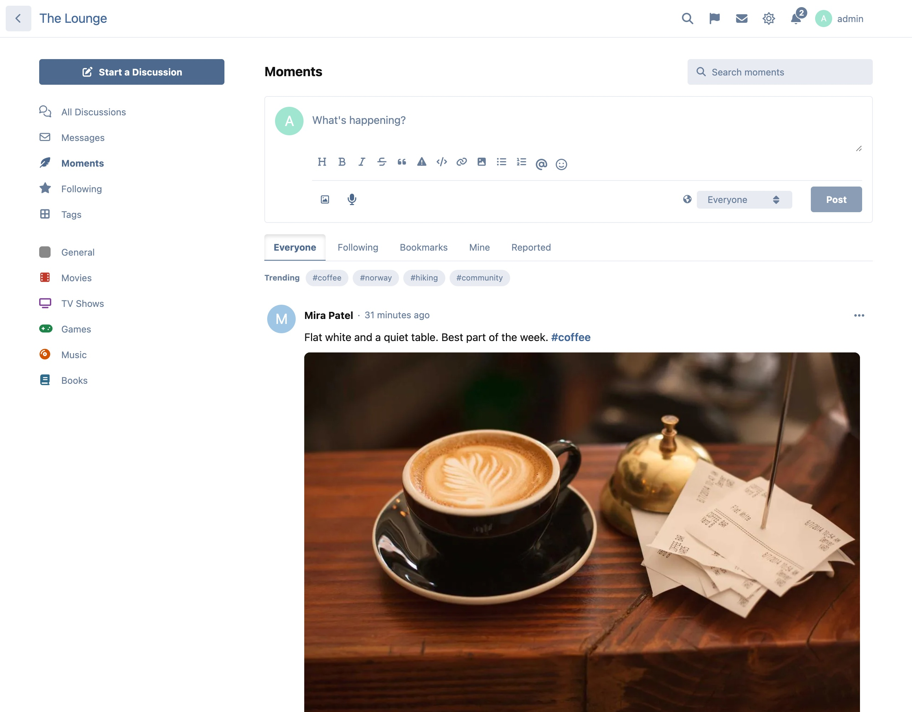
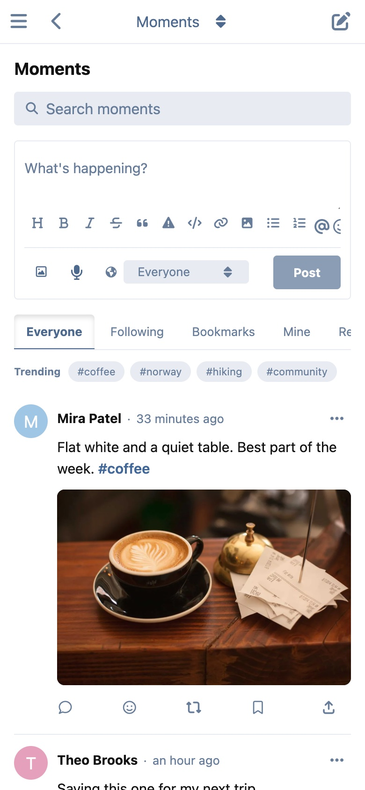

# Moments

**A microblogging social feed for Flarum 2.**

Discussions are for conversations. Moments are for everything smaller: a photo from the weekend, a quick update on what you're building, a voice note, a GIF, a thought you don't want to start a whole thread for. Your members get a timeline beside your discussions, and a Moments tab on every profile.



## What it does

- **A timeline at `/moments`.** Everyone, Following, Bookmarks and your own moments as tabs, newest first, loading more as you scroll. When something new is posted you see "3 new moments — show" instead of the page jumping under you.
- **Photos, video and GIFs.** One photo shows full width, two side by side, three as one tall and two stacked, four as a grid, more as a swipeable carousel. Tap a photo for the full-screen viewer.
- **Voice notes.** Record straight from the browser on a moment or a reply, listen back, then attach it. Works in Chrome, Firefox, Edge and Safari.
- **GIPHY search**, when you add your own API key.
- **Replies in threads**, nested three levels deep (deeper replies line up under the third level), sorted by Recent or Top.
- **Reactions, reposts and quotes.** Repost a moment to your followers, or quote it with your own comment.
- **Private bookmarks.** Only you ever see what you bookmarked.
- **@mentions** that notify, and **#topics** with their own feed, plus trending topics at the top of the page.
- **Link cards.** Paste a link to a discussion, a post, a member or another moment on your forum and it becomes a card. Links to other sites stay plain links.
- **Privacy on each moment:** Everyone, Followers only, or Only me. Replies follow their moment.
- **Search** across moments, by words or by `#topic`, on the Moments page and in the forum's own search.
- **Notifications** for mentions, replies, reposts and reactions (reactions are batched into one per moment), by alert and, for mentions and replies, by email. Each type can be turned off in your settings.
- **Moderation:** hide, delete, lock replies, and a Reported tab for moderators with every report and a button to dismiss them.
- **Widgets** for latest moments, popular topics and a "post a moment" box.
- **Share links** with proper previews: a public moment's own page carries its text and first photo for link previews.



## Install

```
composer require ernestdefoe/moments
```

Then enable **Moments** in the admin panel and check its permissions.

## Update

```
composer update ernestdefoe/moments
php flarum migrate
php flarum cache:clear
```

## Works with your other extensions

Each of these is optional. Moments works without any of them and uses them when they're enabled.

| Extension | What it adds |
| --- | --- |
| **flarum/mentions** | `@name` in a moment notifies that member, and autocompletes as you type. |
| **ernestdefoe/hashtags** | `#topics` in moments are your forum's hashtags. Without it, Moments keeps its own topic index. |
| **ianm/follow-users** | The Following tab, and the Followers only privacy option. Without it, those two are hidden. |
| **fof/reactions** | Moments offer your forum's own reaction set. Without it, a short built-in set of emoji. |
| **fof/upload** | Photos and video go through FoF Upload and its storage (S3 and the rest). Voice notes always use Moments' own storage. |
| **flarum/realtime** | New moments are announced the moment they're posted. Without it, or while its connection is down, the page checks every 30 seconds while you're looking at it. |
| **fof/seo** | A public moment's page gets its tags from FoF SEO. |
| **Bespoke** / **fof/forum-widgets-core** | The three Moments widgets. In FoF Forum Widgets they appear only where you place them. |

Your forum's editor is used to write moments, so Markdown, BBCode, emoji and rich-text editors all work as they do in posts.

## Permissions

Under **Moments** on the Permissions page:

- **View moments**: guests by default.
- **Post moments**, **Reply to moments**, **Add photos and video**, **Record voice notes**, **Add GIFs**: members by default.
- **Moderate moments**: moderators. They can hide, delete and lock, see the Reported tab, and read followers-only moments so they can review reports. Nobody but its author ever sees an Only me moment.

Authors can always delete their own moments and lock replies on them. They can edit for as long as the edit window allows.

## Settings

- **Show Moments in the side navigation.**
- **Longest moment or reply**, 500 characters by default.
- **Who sees a new moment by default.**
- **Edit window** in minutes (0 for no limit).
- **Seconds between one member's moments or replies**, 10 by default. Admins aren't limited.
- **Photos, videos and GIFs per moment**, **largest photo**, **largest video**, **longest voice note**.
- **GIPHY API key** and **highest GIF rating.** Create a free key at [developers.giphy.com](https://developers.giphy.com/). The key stays on your server: searches go through your forum.

## Safe by design

- **Privacy is checked on the server on every path:** the feeds, a moment's page, profile tabs, replies, search, topics, widgets, the new-moments count, link cards, notifications and emails. A moment you can't see is a "not found", never a hint.
- **Uploads are checked by what they are, not what they're called.** Photos are re-encoded (which strips location data), video must be MP4 or WebM, voice notes WebM, Ogg or MP4 audio, and every file gets a random name. SVG, HTML and scripts are refused.
- **Text goes through your forum's formatter,** exactly like posts. Nothing a member types is ever shown as raw HTML.
- **GIFs only come from GIPHY's own media hosts,** checked on the server.
- **Real-time updates carry no content,** only "something new". Each browser then asks for what it's allowed to see.
- **Posting, uploading and GIF searches are rate-limited.**

## Light on your forum

- The JavaScript every page loads adds only the menu link, the profile tab, the notification types and the widget registrations (13 KB, 4.3 KB gzipped). The feed, composer, photo viewer, voice recorder and GIF picker load when they're first used.
- A page of 20 moments costs the same number of database queries as a page of one, for guests and members alike.
- Nothing runs on your discussion pages.

## Troubleshooting

**Followers only and the Following tab are missing.** Install and enable ianm/follow-users.

**There's no GIF button.** Add a GIPHY key in the settings and check the Add GIFs permission.

**There's no microphone button.** The browser doesn't support recording, the page isn't on HTTPS (browsers only allow the microphone on secure pages), or the group lacks Record voice notes.

**"Your browser didn't allow the microphone."** Allow it in the browser's site settings, then try again.

**Uploads fail with "too large".** Check Moments' limits, then your server's `upload_max_filesize` and `post_max_size` in PHP and `client_max_body_size` in nginx.

**Photos don't appear after moving to S3 or another disk.** Moments stores its own files on the `ernestdefoe-moments` disk (`public/assets/moments` by default). Configure that disk like your other Flarum disks, or enable fof/upload for photos and video.

**New moments don't appear by themselves.** Without flarum/realtime the page checks every 30 seconds, and only while the tab is visible.

Unposted uploads (a photo added and then the composer closed) are removed after a day by `php flarum moments:prune`, which runs daily from Flarum's scheduler.

## Links

- [Source](https://github.com/ernestdefoe/moments)
- [Report an issue](https://github.com/ernestdefoe/moments/issues)

Free and open source under the MIT licence.

☕ [Buy me a coffee](https://buymeacoffee.com/ernestdefoe)
